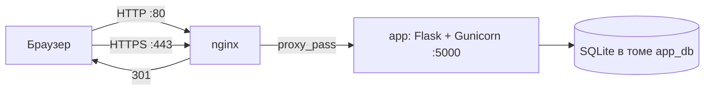

# Garage94 - деплой проекта

Практическая работа №18. Развернул проект локально как на сервере: продакшен-сборка,
контейнеры, nginx, HTTPS и локальный домен. В интернет ничего не публикуется, сайт
открывается только с этого компьютера.

## Архитектура

Приложение на Flask, страницы рендерятся на сервере. Отдельного фронтенда и отдельного
сервиса базы данных нет. Поэтому сервисов два: app и nginx. SQLite это файл внутри
контейнера, он лежит в томе.



Браузер открывает https://garage94.localhost. Запрос принимает nginx, он один доступен
снаружи. Дальше nginx передает запрос приложению на http://app:5000, приложение работает
с SQLite и отдает страницу обратно через nginx.

## Сервисы

| Сервис | Технология | Внутренний порт | Продакшен-сервер |
| --- | --- | --- | --- |
| app | Flask 3, Python 3.12 | 5000 | Gunicorn, 2 workers |
| nginx | nginx 1.30-alpine | 80, 443 | нет |
| db | SQLite, файл в томе app_db | нет | нет |

Порты открыты только у nginx и только на 127.0.0.1, поэтому сайт доступен только с этого
компьютера. У app ключа ports нет, он виден только внутри сети Docker Compose.

## Переменные окружения и секреты

Только имена, без значений:

| Имя | Где задается | Зачем |
| --- | --- | --- |
| DEBUG | docker-compose.yml | режим отладки, тут False |
| DATABASE_URL | docker-compose.yml | путь к файлу SQLite в томе |
| SECRET_KEY | deploy/.env | секретный ключ Flask |

Для запуска без Docker используются переменные из `.env` в корне проекта, пример лежит
в `.env.example`: SECRET_KEY, DEBUG, DATABASE_URL.

Перед первым запуском нужно создать deploy/.env с ключом:

```bash
python -c "import secrets; print(secrets.token_urlsafe(48))"
```

Полученное значение записать в файл строкой `SECRET_KEY=...`. Файл в репозиторий не
попадает, он в `.gitignore`. Сертификаты тоже не попадают в репозиторий и в Docker-образ.

## Запуск и остановка

Команды выполняются в папке deploy:

```bash
docker compose up --build -d     # собрать и запустить
docker compose ps                # проверить состояние
docker compose logs app          # журнал приложения
docker compose logs nginx        # журнал nginx
docker compose down              # остановить
```

После первого запуска база пустая, каталог заполняется командой:

```bash
docker compose exec app flask seed
```

Сайт открывается по адресу https://garage94.localhost. Если открыть http, будет редирект
301 на https.

Сертификат выпущен через mkcert:

```bash
mkcert -cert-file garage94.localhost.pem -key-file garage94.localhost-key.pem garage94.localhost
```

## Скриншоты

- `screenshots/docker_compose_ps.png` - вывод docker compose ps;
- `screenshots/site_https.png` - сайт по адресу https://garage94.localhost, в адресной
  строке замок;
- `screenshots/network_headers.png` - вкладка Network с запросом и заголовками ответа;
- `screenshots/docker_desktop_containers.png` - контейнеры в Docker Desktop с портами.

Отдельного API в проекте нет, страницы делает сам Flask. Поэтому на вкладке Network
показан запрос документа https://garage94.localhost/ и его заголовки: Server nginx/1.30.6,
Content-Type text/html, Content-Encoding gzip.

## Ошибки и как исправил

1. `failed to connect to the docker API ... dockerDesktopLinuxEngine` - Docker Desktop
   не был запущен. Запустил Docker Desktop и подождал, пока заработает демон.
2. `sqlite3.OperationalError: table users already exists` - при первом запуске два воркера
   Gunicorn одновременно создавали таблицы. Контейнер упал и перезапустился сам
   (в compose стоит `restart: unless-stopped`), со второго раза все поднялось.
3. Каталог был пустой после первого запуска - база создается пустой. Заполнил командой
   `docker compose exec app flask seed`.
4. `curl: schannel: CRYPT_E_NO_REVOCATION_CHECK` - у локального центра сертификации mkcert
   нет списков отзыва, и curl со schannel не хочет проверять такой сертификат. В Edge
   сайт открывается без предупреждений, а для curl использовал `--ssl-no-revoke`.
5. Docker Desktop один раз завершился во время работы, контейнеры остановились и браузер
   показывал `ERR_CONNECTION_REFUSED`. Запустил Docker Desktop заново и выполнил
   `docker compose up -d`.
6. Если поменять код, образ надо пересобрать командой `docker compose up --build -d`,
   иначе изменения не появятся.

## Что поменять для публикации на реальном сервере

- арендовать сервер или хостинг и поставить туда Docker;
- зарегистрировать настоящий домен и сделать A-запись на IP сервера;
- получить сертификат в Let's Encrypt через Certbot и прописать его в nginx;
- убрать 127.0.0.1 у портов nginx, чтобы сайт был доступен из сети;
- хранить SECRET_KEY не в локальном файле, а в хранилище секретов;
- настроить CD, чтобы сервер сам забирал готовый образ из реестра и перезапускал контейнер.

CI обязательный: `.github/workflows/docker-build.yml` при push, pull request и ручном
запуске проверяет, что Docker-образ собирается. Публикацию образа в реестр и обновление
проекта из реестра (CD) в этой работе не делал, это дополнительное задание.
