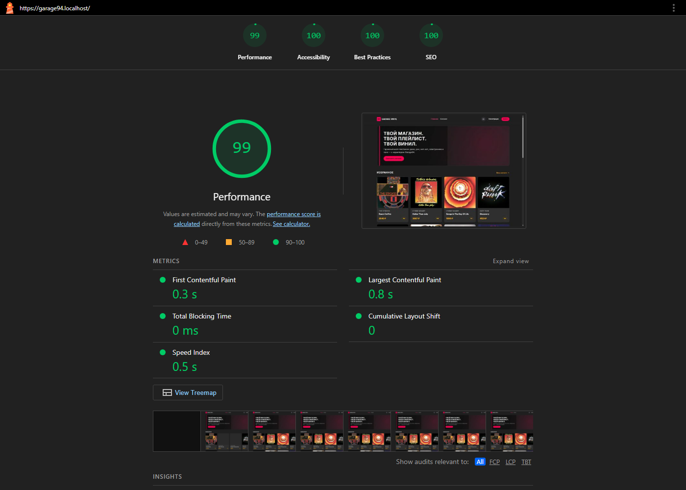
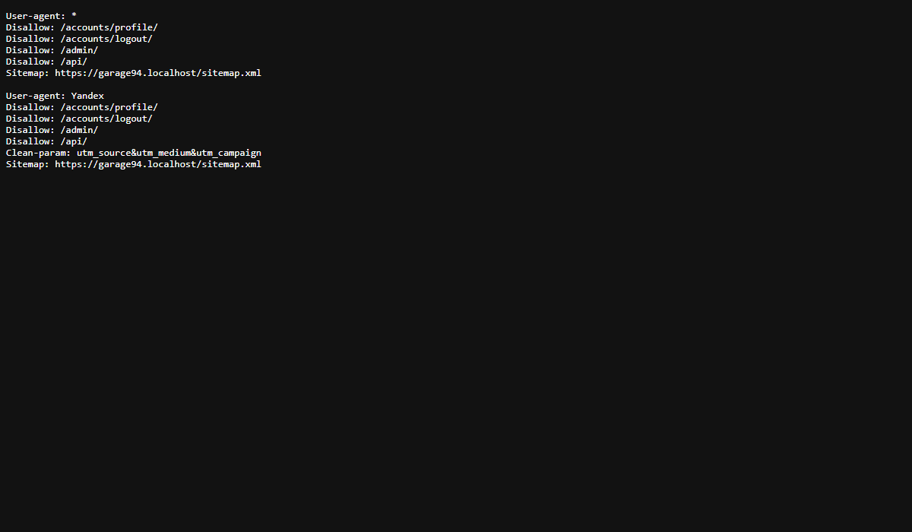
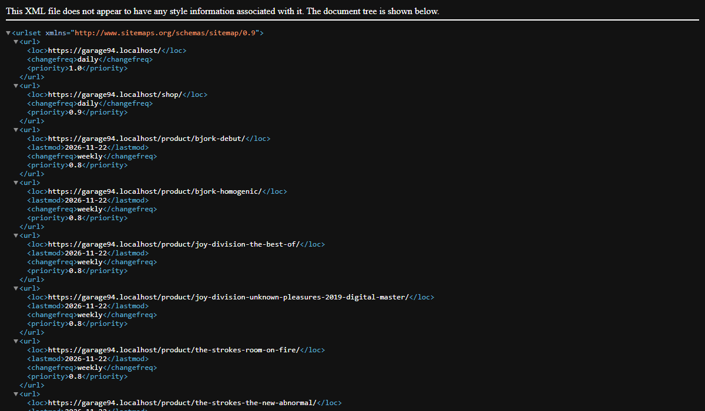
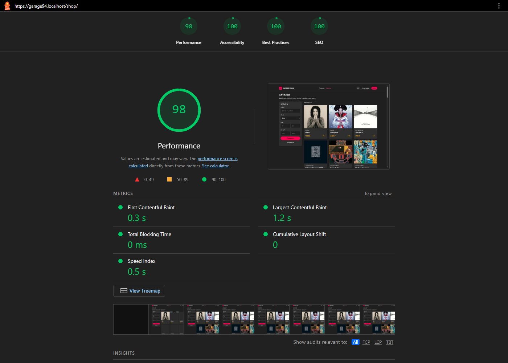
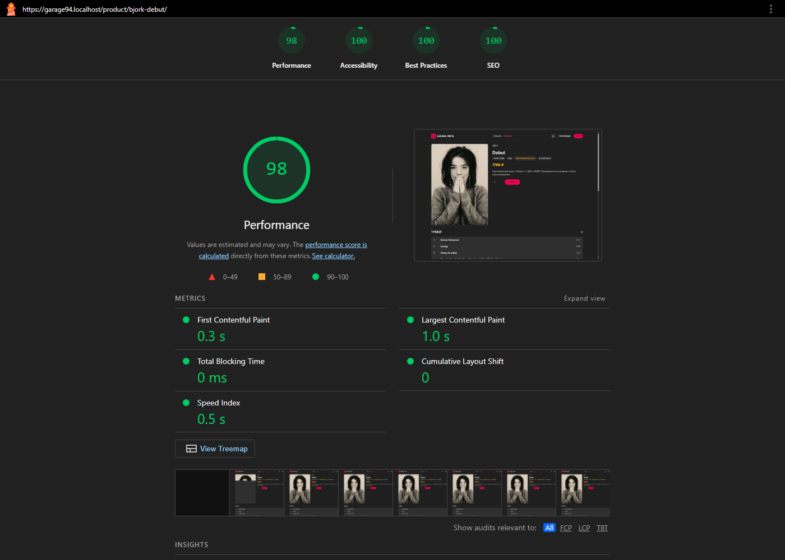
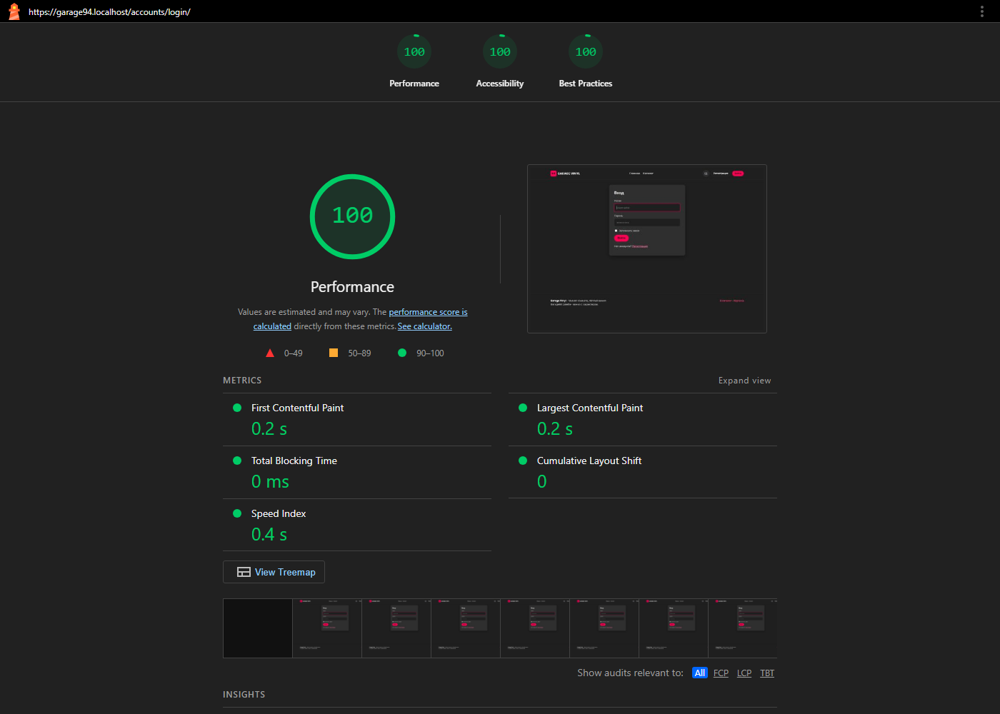

# Аудит проекта Garage94

Практическое занятие №20. Полный аудит проекта, запущенного локально в продакшен-режиме
(https://garage94.localhost). Проверены все основные страницы, метрики Core Web Vitals,
метатеги, robots.txt, sitemap.xml и работа с клавиатуры. По результатам составлен список
проблем, исправлены самые важные, сделан повторный замер.

Аудит выполнялся на продакшен-сборке в Docker, в режиме Desktop, браузер Microsoft Edge.
Lighthouse запускался через CLI в headless-режиме, поэтому результаты стабильнее, чем при
ручных запусках, но условия те же: один компьютер, локальная сеть, без реальной сети.

## 1 Проверенные страницы

| Страница | Тип | Как проверялась | Категории Lighthouse |
| --- | --- | --- | --- |
| / | публичная, есть в sitemap.xml | 3 запуска | все 4 |
| /shop/ | публичная, есть в sitemap.xml | 3 запуска | все 4 |
| /product/bjork-debut/ | публичная, есть в sitemap.xml | 3 запуска | все 4 |
| /accounts/login/ | noindex | 3 запуска | без SEO |
| /accounts/register/ | noindex | вручную | без SEO |
| /cart/ | noindex | 3 запуска | без SEO |
| /accounts/profile/ | нужен вход, закрыта в robots.txt | вручную | не проверялась |

## 2 Результаты Lighthouse до доработки

| Страница | Performance (3 запуска) | Медиана | Accessibility | Best Practices | SEO |
| --- | --- | --- | --- | --- | --- |
| / | 95, 98, 98 | 98 | 100 | 100 | 100 |
| /shop/ | 95, 94, 95 | 95 | 100 | 100 | 100 |
| /product/bjork-debut/ | 97, 97, 97 | 97 | 94 | 100 | 100 |
| /accounts/login/ | 100, 100, 100 | 100 | 91 | 100 | не проверялась |
| /cart/ | 100, 100, 100 | 100 | 100 | 100 | не проверялась |

Метрики запуска с медианной оценкой:

| Страница | FCP | LCP | TBT | CLS | Speed Index |
| --- | --- | --- | --- | --- | --- |
| / | 0,3 с | 1,1 с | 0 мс | 0 | 0,4 с |
| /shop/ | 0,3 с | 1,5 с | 0 мс | 0 | 0,5 с |
| /product/bjork-debut/ | 0,3 с | 1,2 с | 0 мс | 0 | 0,4 с |
| /accounts/login/ | 0,3 с | 0,3 с | 0 мс | 0 | 0,3 с |
| /cart/ | 0,3 с | 0,3 с | 0 мс | 0 | 0,4 с |

Отчеты Lighthouse сохранены в папке `reports/`: `home.html`, `shop.html`, `product.html`,
`login.html`, `cart.html`.



### Сравнение с прошлыми замерами

На занятии 70-71 уже делались замеры Lighthouse: `docs/seo/before.png` и `docs/seo/after.png`.
Тогда SEO поднялось с 80 до 100 баллов после добавления метатегов, robots.txt и sitemap.xml.
Сейчас SEO на всех публичных страницах остается 100, то есть прошлые исправления не сломались.

| Показатель | Занятие 70-71 (до) | Занятие 70-71 (после) | Сейчас |
| --- | --- | --- | --- |
| SEO в Lighthouse | 80 | 100 | 100 |
| Мета-описание | нет | есть | есть на всех страницах |

## 3 Core Web Vitals

| Метрика | /shop/ | Оценка | Комментарий |
| --- | --- | --- | --- |
| LCP | 1,0 с | хорошо | самая крупная картинка это обложка первой пластинки |
| INP | около 0 мс | хорошо | на странице нет JavaScript-обработчиков, все переходы идут с перезагрузкой страницы |
| CLS | 0 | хорошо | у картинок заранее указаны ширина и высота, макет не сдвигается |

Пороговые значения: LCP до 2,5 с, INP до 200 мс, CLS до 0,1. Все три метрики в зеленой зоне.

## 4 Ручные проверки

| Проверка | Страница | Результат | Комментарий |
| --- | --- | --- | --- |
| Атрибут lang у html | все | есть | lang="ru" |
| Тег title | все | есть | свой у каждой страницы |
| Метатег description | все | есть | свой, 100-160 символов |
| Содержимое в исходном HTML | /shop/ | есть | карточки рендерятся на сервере, JS не нужен |
| Атрибут alt у картинок | /shop/, /product/ | есть | исполнитель и название пластинки |
| Метатег noindex | /accounts/login/, /accounts/register/, /cart/, /accounts/profile/ | есть | страницы закрыты от индексации |
| Файл robots.txt | - | есть | открывается, адрес sitemap правильный |
| Файл sitemap.xml | - | есть | 49 адресов, все публичные страницы |
| Навигация с клавиатуры | / | есть | фокус виден, добавлены стили focus-visible |
| Мобильная версия | - | частично | есть media-запросы для каталога и карточки товара, полной адаптации нет |





## 5 Сравнение с сайтом-аналогом

В качестве аналога взят магазин винила Vinyl Me, Please (vinylmeplease.com). Проверка
выполнена в Lighthouse в мобильном режиме, потому что PageSpeed Insights в момент работы
отвечал ошибкой 429 и полевые данные получить не удалось.

| Показатель | Наш проект (Desktop, локально) | Аналог (Mobile, Lighthouse) |
| --- | --- | --- |
| Performance | 99 | 42 |
| Accessibility | 100 | 76 |
| Best Practices | 100 | 73 |
| SEO | 100 | 83 |
| LCP | 1,0 с | 7,7 с |
| TBT | 0 мс | 670 мс |
| CLS | 0 | 0 |

Выводы:

- у аналога LCP 7,7 с, то есть главная картинка загружается очень долго. У нас LCP 1,0 с,
  потому что страницы рендерятся на сервере и картинки отдаются в уменьшенном размере;
- у аналога много JavaScript: TBT 670 мс. У нас JavaScript почти нет, поэтому TBT 0 мс;
- CLS у обоих проектов равен нулю, то есть размеры блоков заданы заранее;
- цифры сравнивать напрямую нельзя: аналог проверялся как мобильный сайт с замедлением
  процессора и сети, а наш проект на Desktop и локальном сервере. Но общий вывод такой:
  серверный рендеринг и легкие страницы дают заметно лучшие метрики.

## 6 Найденные проблемы и приоритеты

| Приоритет | Проблема | Страница | Влияние | Сложность | Как исправить |
| --- | --- | --- | --- | --- | --- |
| 1 | Картинки слишком большие: экономия 2464 КиБ на главной, 4766 КиБ в каталоге | /, /shop/ | высокое | низкая | отдавать обложки меньшего размера |
| 2 | LCP-картинка с loading=lazy, без fetchpriority | /, /shop/ | высокое | низкая | eager и fetchpriority=high для первой картинки |
| 3 | В robots.txt адрес sitemap указывал на example.com | - | высокое | низкая | собирать robots.txt на сервере из SITE_URL |
| 4 | Страницы с noindex закрыты в robots.txt | login, register, cart | среднее | низкая | убрать их из Disallow |
| 5 | Низкий контраст ссылки и ссылка без подчеркивания | /accounts/login/ | среднее | низкая | изменить цвет и добавить подчеркивание |
| 6 | У поля количества нет подписи | /product/ | среднее | низкая | добавить label |
| 7 | Не виден фокус при работе с клавиатуры у ссылок и кнопок | все | среднее | низкая | добавить стили focus-visible |
| 8 | Остались большие картинки для показа 264 px | /, /shop/ | низкое | средняя | responsive images и WebP/AVIF |
| 9 | Нет полной мобильной адаптации | все | высокое | высокая | переверстать страницы под телефон |

## 7 Что исправлено и повторный замер

Исправлены проблемы 1-7:

- обложки в карточках теперь запрашиваются в размере 500x500 вместо 1000x1000, обложка
  товара 600x600;
- первая картинка на странице загружается сразу: loading="eager" и fetchpriority="high";
- robots.txt собирается на сервере и указывает sitemap по адресу сайта, страницы с noindex
  из Disallow убраны;
- у ссылки на регистрацию изменен цвет и добавлено подчеркивание;
- у поля количества добавлена подпись;
- добавлены стили focus-visible для ссылок, кнопок и полей.

Повторный замер (3 запуска):

| Страница | Performance до | Performance после | Accessibility до | Accessibility после |
| --- | --- | --- | --- | --- |
| / | 98 | 97 | 100 | 100 |
| /shop/ | 95 | 99 | 100 | 100 |
| /product/bjork-debut/ | 97 | 98 | 94 | 100 |
| /accounts/login/ | 100 | 100 | 91 | 100 |

На главной оценка изменилась на 1 балл в пределах разброса между запусками (до: 95, 98, 98,
после: 97, 96, 98), LCP тоже колеблется от 1,1 до 1,3 с. В каталоге LCP стал 1,0 с вместо
1,5 с, экономия на картинках снизилась с 4766 до 1192 КиБ.








## 8 Что осталось неисправленным

- картинки в каталоге все еще больше, чем показываются на экране: экономия 649 КиБ на
  главной и 1192 КиБ в каталоге. Нужны responsive images и формат WebP/AVIF;
- полной мобильной верстки нет, а Google индексирует в первую очередь мобильную версию;
- файл стилей блокирует отображение страницы (render-blocking), его можно вынести в
  отдельный запрос с preload;
- часть страниц (регистрация, профиль) проверена только вручную, без Lighthouse, потому
  что профиль требует входа.

## 9 Как запускалось

```bash
git clone https://github.com/k1sor/garage94
git clone https://github.com/k1sor/garage94-deploy
cd garage94-deploy
docker compose up --build -d
docker compose exec app flask seed
```

Lighthouse:

```bash
npx lighthouse https://garage94.localhost/ --preset=desktop \
  --only-categories=performance,accessibility,best-practices,seo \
  --output=html --output-path=docs/audit/reports/home.html
```
